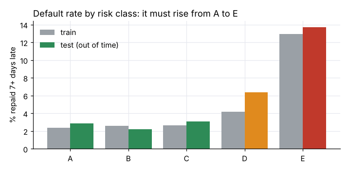
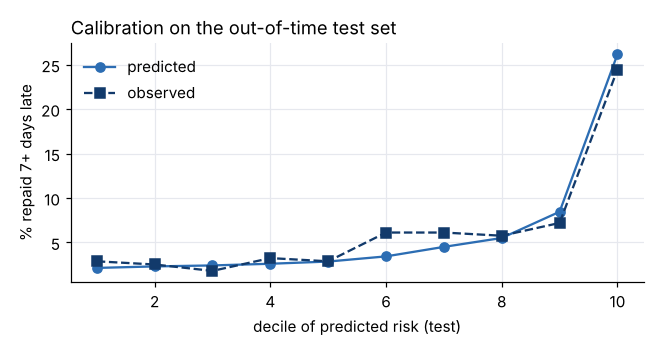
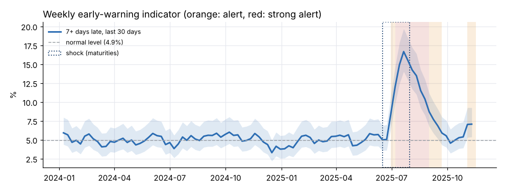

# Micro-loan credit scoring: from a repayment ledger to a scorecard and an early-warning indicator

End-to-end credit-risk project on short micro-loans repaid in a single instalment: building an exact default target from transaction-level repayments, engineering leakage-free features, fitting a WOE logistic regression scorecard, validating it out of time, and monitoring the portfolio with a weekly early-warning indicator.

> All data are **synthetic** (generated by [`data/generate_data.py`](data/generate_data.py)). The project is inspired by real micro-lending practice, but contains no real customer or institution data.

## Key results

| | |
|---|---|
| Data | 26,970 loans to 3,600 customers, 12 branches, 64,618 ledger transactions (2023–2025) |
| Target | repaid **7+ days late** (5.5% of observable loans) |
| Snapshots vs. ledger | month-end portfolio extracts see only **45%** of the late payments found in the ledger (622 of 1,396) |
| Model | WOE logistic regression on 3 variables known at application time |
| Out-of-time test | **Gini 0.46** (95% CI 0.37–0.54), KS 0.36, population stability PSI 0.03 |
| Business use | risk class E = 26% of loans but **57% of late payments** (13.7% default rate vs. 3.7% for the others) |
| Early warning | **no false alarm in 76 weeks**; a portfolio-wide shock detected 14 days after the first affected maturity |

<p align="center">
  
  
</p>
<p align="center"></p>

## Approach

1. **Exact target from the ledger.** A loan is settled on the first day cumulative principal repaid reaches 99.9% of the amount; days late = settlement date − maturity date. Loans still open at the extraction date are censored (late by at least the time elapsed). Only loans with 45 days of hindsight are modelled.
2. **Leakage-free features.** For each loan, the customer's history is rebuilt *as it was known on the booking date*: worst delay on the last 3 loans, share of previous loans repaid 7+ days late, days since the previous maturity, number of previous loans, term, amount.
3. **Binning, WOE and IV** learnt on the training period only, with business-meaningful bin edges (0 / 1–6 / 7+ days late).
4. **Logistic regression** with variable selection on IV, redundancy (|correlation| > 0.6), significance and coefficient sign.
5. **Out-of-time validation**: Gini with a bootstrap confidence interval, KS, calibration by decile, PSI.
6. **Scorecard**: points scaled so that 600 points = 10 goods per bad and +20 points double the odds; five risk classes A–E.
7. **Early-warning indicator**: weekly share of loans repaid 7+ days late among those that matured over the last 30 days, with a Wilson confidence interval and two alert levels. A shock common to all customers is excluded from model training: no individual score can predict it, but this indicator catches it.

## Repository

```
├── data/
│   ├── generate_data.py      synthetic loans and repayment ledger
│   ├── loans.csv
│   └── repayments.csv
├── notebooks/
│   └── credit_scoring.ipynb  the full analysis, with outputs
├── src/
│   └── scorecard.py          binning, WOE/IV, Gini, KS, PSI, Wilson interval, scaling
└── reports/figures/          charts used in this README
```

## Run it

```bash
pip install -r requirements.txt
python data/generate_data.py          # optional: regenerate the data
jupyter notebook notebooks/credit_scoring.ipynb
```

## Tools

Python · pandas · NumPy · statsmodels · scikit-learn · Matplotlib · Jupyter

## Author

**Maguy Toukem**, Data Analyst and computer engineering student (UCAC-ICAM, Cameroon)
[LinkedIn](https://www.linkedin.com/in/maguy-toukem-276ba030a) · [Kaggle](https://www.kaggle.com/maguytoukem)
